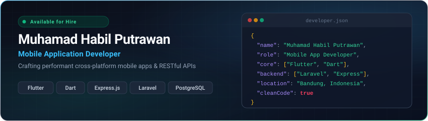

  

  
  
  
  

---

### 👨‍💻 About Me

I am a passionate **Mobile Application Developer** and Software Engineer from Indonesia, dedicated to engineering clean, responsive, and intuitive cross-platform applications. My core expertise centers on **Flutter & Dart**, with solid hands-on experience building structured **RESTful APIs** using **Laravel** and **Node.js / Express**.

- 📱 **Mobile Development**: Crafting pixel-perfect, native-feeling UIs, robust state management, and seamless animations with Flutter.
- ⚙️ **Backend & APIs**: Developing secure backend services, JWT authentication, and database schemas with Laravel, Express.js, and PostgreSQL / MySQL.
- 📐 **Architecture & Clean Code**: Committed to modular code, separation of concerns, and maintainable software engineering practices.
- 🚀 **Currently Exploring**: Advanced Flutter architecture, CI/CD pipelines for mobile, and AI-powered mobile capabilities.
- 💼 **Open For**: Mobile Developer roles, Software Engineer internships, and impactful open-source collaborations.

---

### 🛠️ Tech Stack & Tools

<table>
  <tr>
    <td width="22%" align="center"><b>Mobile</b></td>
    <td>
      
      
      
    </td>
  </tr>
  <tr>
    <td align="center"><b>Backend & APIs</b></td>
    <td>
      
      
      
      
      
      
    </td>
  </tr>
  <tr>
    <td align="center"><b>Database & Cloud</b></td>
    <td>
      
      
      
    </td>
  </tr>
  <tr>
    <td align="center"><b>Tools & Workflow</b></td>
    <td>
      
      
      
      
      
      
    </td>
  </tr>
</table>

---

### 📂 Featured Projects

| Project | Tech Stack | Description | Link |
|:---|:---|:---|:---:|
| **Basket Court Booking App** | `Flutter` `Dart` | Mobile application for sports arena reservation with intuitive UI slicing, real-time schedule preview, and smooth booking flow. | [View Code](https://github.com/mhpcieo/Slicing_fieldloan) |
| **Buy Ticket App** | `Flutter` `Dart` | Cross-platform ticketing platform complete with an administrative dashboard, responsive layouts, and organized data visualization. | [View Code](https://github.com/mhpcieo/slicingtiket) |
| **Hurben Rekreasi Platform** | `Laravel` `MySQL` `PHP` | Amusement park ticket booking system featuring secure JWT authentication, input validation, and clean RESTful API architecture. | [View Code](https://github.com/mhpcieo/Hurbenrekreasi) |
| **FE Inventaris App** | `Flutter` `Dart` | Mobile inventory management interface for tracking internal organization assets, loans, and item statuses. | [View Code](https://github.com/muhamadhabilputrawan/FE-Inventaris-Flutter) |
| **Counseling Management System** | `JavaScript` `Express` | Fullstack counseling and student guidance management system built for institutional record keeping. | [View Code](https://github.com/muhamadhabilputrawan/FE-Ujikel-) |

---

### 📊 GitHub Analytics

  
  

---

  Designed with precision for professional impact &bull; © <b>Muhamad Habil Putrawan</b>

